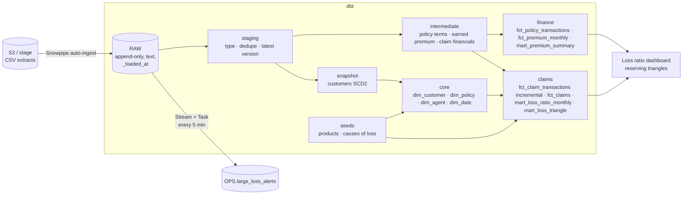

# Snowflake + dbt Insurance Data Warehouse

[](https://github.com/sumaksharikaa/snowflake-dbt-insurance-warehouse/actions/workflows/ci.yml)


This is a **property & casualty (P&C) insurance data warehouse** built with **dbt on Snowflake**. It models the full
policy and claims lifecycle (written and earned premium, cancellations with return premium, claim reserves, payments
and recoveries) and produces the numbers an insurer runs on: **earned premium, unearned premium reserve, loss
ratios (with and without catastrophe losses) and loss development triangles**.

The same dbt project runs on **Snowflake** in production and on **DuckDB** locally and in CI, so anyone can clone it
and run `make demo` without a Snowflake account. Snowflake-native ingestion, streaming and governance
(Snowpipe, Streams & Tasks, RBAC, masking and row access policies) live in [`snowflake/`](snowflake/).

> **Note:** this is a personal portfolio project. All data is synthetic, produced by the included generator.
> No client code or data is used.

---

## Architecture



| Layer | Materialization | What happens |
|---|---|---|
| `staging` | views | Cast from text with `try_cast`, standardize, keep the latest version per key (`qualify row_number()`), collapse re-delivered rows |
| `snapshots` | snapshot | `customers_snapshot`: SCD Type 2 history with the timestamp strategy |
| `intermediate` | views | Policy terms, **pro-rata daily premium earning**, claim financials (paid / reserve / recovery / incurred) |
| `marts/core` | tables | Conformed dimensions, including the SCD2 `dim_customer` with surrogate keys |
| `marts/finance` | tables | Written and earned premium, cumulative totals, unearned premium reserve, policies in force |
| `marts/claims` | tables + **incremental** | Claim transactions (`unique_key` merge), claim facts with a point-in-time customer join, loss ratios, triangles |

## What it demonstrates

**Insurance domain**
- **Earned premium, done properly.** Each transaction's written premium earns evenly by day over its exposure
  period. Cancellations carry negative premium that exactly offsets the earnings after the cancel date, and
  endorsements earn over the rest of the term. Each month is rounded to cents and the last month takes the remainder,
  so earned always reconciles to written *to the cent*. A test enforces this for every one of the 8,366 transactions.
- **Claim reserving.** Case reserves, payments with reserve take-downs, and salvage/subrogation recoveries combine
  into incurred loss (`paid + case reserve − recovered`).
- **Loss ratio, with and without catastrophes.** A simulated Texas hail storm adds catastrophe losses, and the mart
  reports both views.
- **Loss development triangles** by accident quarter × development quarter, with every cell present so cumulative
  values carry forward. [`analyses/chain_ladder_factors.sql`](dbt/analyses/chain_ladder_factors.sql) pivots the triangle
  and computes volume-weighted age-to-age factors for a chain-ladder reserve review.
- **Point-in-time correctness.** Each claim joins to the customer version (credit tier, state) that was valid *on
  the loss date*.

**dbt engineering**
- **Incremental model** (`fct_claim_transactions`) filtered on ingestion time (`_loaded_at`), so late-arriving
  transactions are never missed. `unique_key` turns re-delivered rows into updates, using `MERGE` on Snowflake and
  `delete+insert` on DuckDB. CI proves it: 2,292 raw rows including 25 re-deliveries → 2,267 unique facts.
- **Snapshot (SCD2)** of customers across two loads: 166 customers gain history (relocations, credit re-scores).
- **75 tests:**
  - **3 unit tests** (dbt 1.8+): pro-rata earning with the rounding plug, cancellation offset, and the incurred-loss formula.
  - **68 generic tests**, including project-local `not_negative`, `value_between`, `expression_is_true` and `unique_combination` (no packages needed).
  - **4 singular reconciliations**: earned = written, loss-ratio mart = claim totals, closed claims carry no reserve, and cumulative paid is never negative.
- **Cross-database macros** with `adapter.dispatch` (a date spine with Snowflake `generator()` vs DuckDB `range()`),
  plus `dbt.datediff` / `dbt.dateadd`, so one codebase targets both engines.
- **Environment-aware schemas** (`generate_schema_name`): production uses clean schema names, while dev and CI are prefixed.
- **Source freshness**, **exposures** (dashboard + reserving analysis), **persisted docs**, and **store_failures** for test triage.

**Snowflake platform** ([`snowflake/`](snowflake/))
- **RBAC.** LOADER / TRANSFORMER / REPORTER / PII_READER roles with future grants, a key-pair-authenticated
  service user, right-sized auto-suspending warehouses, a multi-cluster BI warehouse and a resource monitor.
- **Snowpipe.** A storage integration, external stage and auto-ingest pipes that record `metadata$filename`.
- **Streams & Tasks.** An append-only stream plus a serverless task (runs only when `SYSTEM$STREAM_HAS_DATA`) that
  routes large payments and reserve changes to an alert table within minutes, between batch runs.
- **Governance.** Masking policies for email, phone and date of birth (masked unless the role is `PII_READER`), a
  region-based row access policy, and a `data_classification` tag. dbt post-hooks re-apply the policies every time a
  customer model is rebuilt (`apply_pii_masking` macro).

## Results from a sample run

Two years of a personal-lines book (3,000 customers, 3,967 policies, 7,187 policy terms), built with `make demo`:

| Metric | Value |
|---|---|
| Written premium | $8.10M across 8,366 policy transactions (NEW / RENEWAL / ENDORSEMENT / CANCELLATION) |
| Earned premium through 2025-12-31 | $6.17M |
| Unearned premium reserve at 2025-12-31 | $1.93M |
| Claims | 488 (89 from the hail catastrophe, 135 still open) |
| Incurred losses | $3.26M, **loss ratio 52.8%** |
| Homeowners loss ratio | 64.2% including CAT, **50.6% ex-CAT** |
| Auto paid age-to-age factors | 3.79 → 1.23 → 1.06 → 1.00 |
| `dbt build` | 99 nodes, all passing, on both loads |

## Quickstart (no Snowflake account needed)

```bash
git clone https://github.com/sumaksharikaa/snowflake-dbt-insurance-warehouse.git
cd snowflake-dbt-insurance-warehouse
python -m venv .venv && source .venv/bin/activate
make install   # dbt-core, dbt-duckdb, dbt-snowflake
make demo      # generate 2 extracts; load 1 -> dbt build; load 2 -> dbt build
make docs      # lineage graph and column docs at http://localhost:8080
```

Query the marts:

```bash
python -c "import duckdb; print(duckdb.connect('data/warehouse.duckdb').sql(
  'select product_line, sum(earned_premium) earned, sum(incurred_loss) incurred, '
  'round(sum(incurred_loss)/sum(earned_premium),3) loss_ratio '
  'from analytics_claims.mart_loss_ratio_monthly group by 1 order by 1'))"
```

## Running on Snowflake

1. Run `snowflake/01_setup_rbac.sql` through `04_governance.sql` in order (replace the `<…>` placeholders).
2. Set `SNOWFLAKE_ACCOUNT`, `SNOWFLAKE_USER` and `SNOWFLAKE_PRIVATE_KEY_PATH`, then:
   ```bash
   cd dbt && DBT_TARGET=snowflake DBT_PROFILES_DIR=. dbt build
   ```
3. Schedule `dbt build` (Airflow, GitHub Actions or dbt Cloud) after the Snowpipe loads; source freshness alerts if a feed stops.

## Project structure

```
├── data_generator/                 # synthetic P&C book: policies, endorsements, cancellations, claims, CAT event
├── scripts/load_raw.py             # local stand-in for Snowpipe (append-only RAW with _loaded_at)
├── dbt/
│   ├── models/staging/             # sources, typing, dedupe, latest version
│   ├── models/intermediate/        # policy terms, earned premium (+ unit tests), claim financials
│   ├── models/marts/{core,finance,claims}/
│   ├── snapshots/                  # customers SCD2
│   ├── macros/                     # cross-db dispatch, schema naming, PII masking post-hook
│   ├── tests/generic/              # project-local generic tests
│   ├── tests/singular/             # financial reconciliations
│   ├── seeds/                      # product lines, causes of loss
│   └── analyses/                   # chain-ladder factors
└── snowflake/                      # RBAC, Snowpipe, Streams & Tasks, governance
```

## License

MIT
